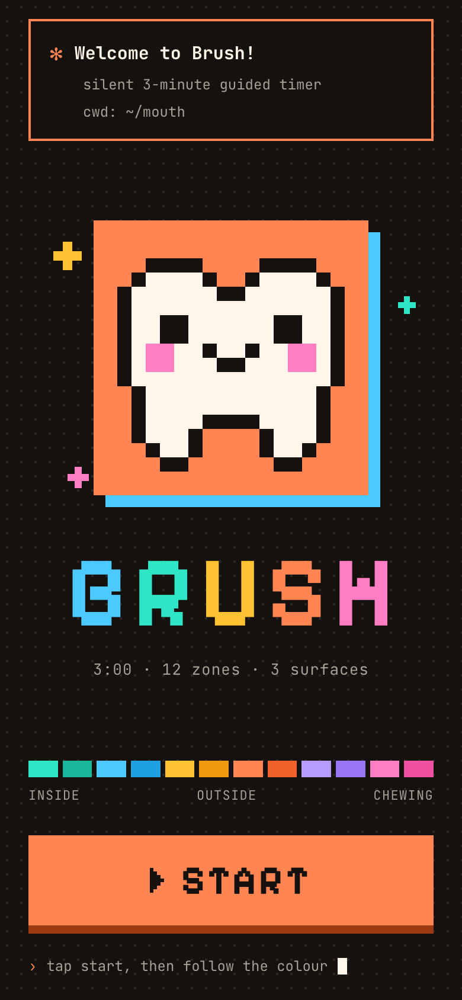
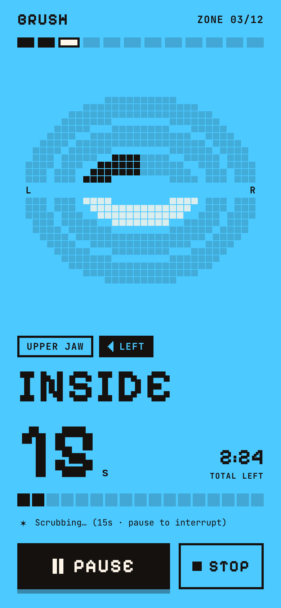
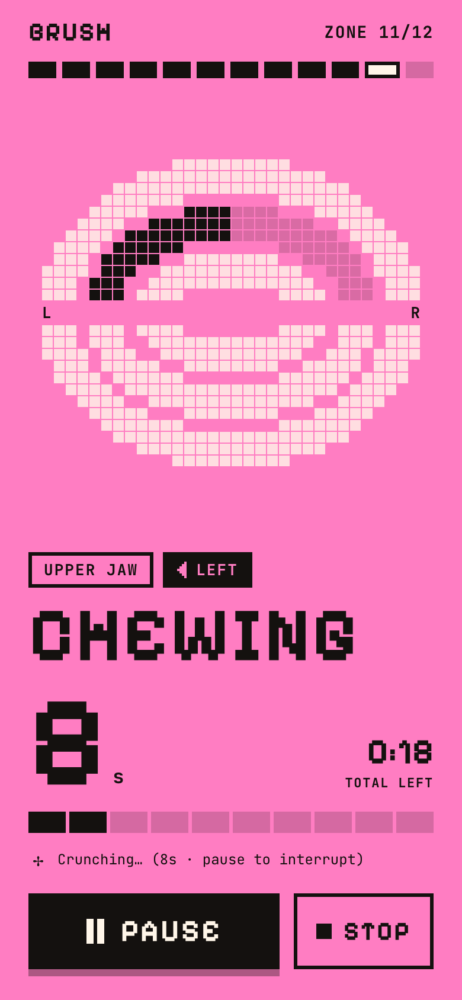
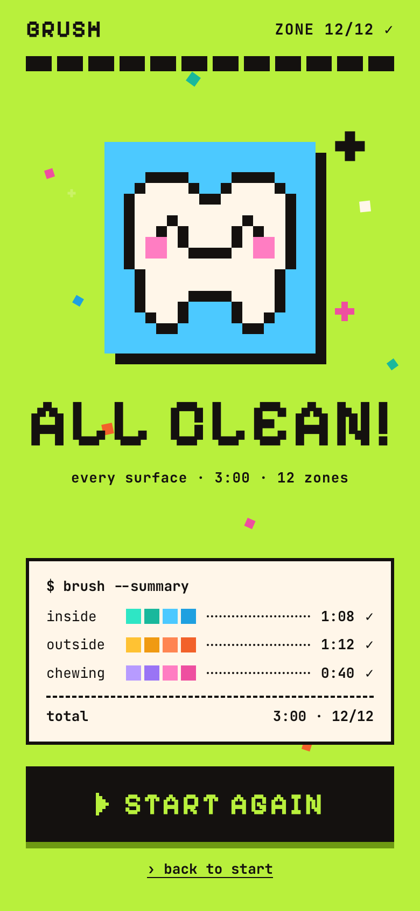

# Brush

A silent, guided 3-minute toothbrushing timer, built as a Progressive Web App
so it can live on the iPhone home screen without an App Store account.

<p align="center">
  
  
  
  
</p>

<p align="center"><em>Start · one bold colour per zone · finished teeth turn white · all clean!</em></p>

Press **Start** and it walks through **12 zones in 3 minutes**. At every switch
the whole background changes to that zone's colour. On a pixel map of the two
tooth arches the zone to brush blinks slowly in black, and when it's done its
pixels turn white from left to right. The screen flashes once when you're
finished. No sound, ever.

The look is pixel art in a terminal style: a pixel tooth mascot, chunky
square buttons with hard shadows, and animation that moves in whole steps like
an 8-bit game. People whose phones are set to reduce motion get a still
version.

Zones are not all the same length — the insides and outsides carry most of the
plaque, so the chewing surfaces give time up to them:

| Surface | Zones | Each | Subtotal |
|---|---|---|---|
| Inside | 4 | 17s | 68s |
| Outside | 4 | 18s | 72s |
| Chewing | 4 | 10s | 40s |
| | | | **180s = 3:00** |

| # | Zone | Length | # | Zone | Length |
|---|---|---|---|---|---|
| 1 | Lower Inside — Left | 17s | 7 | Upper Outside — Left | 18s |
| 2 | Lower Inside — Right | 17s | 8 | Upper Outside — Right | 18s |
| 3 | Upper Inside — Left | 17s | 9 | Lower Chewing — Left | 10s |
| 4 | Upper Inside — Right | 17s | 10 | Lower Chewing — Right | 10s |
| 5 | Lower Outside — Left | 18s | 11 | Upper Chewing — Left | 10s |
| 6 | Lower Outside — Right | 18s | 12 | Upper Chewing — Right | 10s |

To retune, edit the one `SECONDS` table at the top of `app.js`; everything else
follows from it.

## Files

| File | What it does |
|---|---|
| `index.html` | Markup and iOS meta tags for the three screens |
| `styles.css` | Layout, fonts, animations, flash, safe-area insets |
| `app.js` | Timer, zone colours, pixel art (mouth map and tooth), screen wake lock |
| `manifest.json` | Makes it installable: name, icons, fullscreen display |
| `sw.js` | Service worker — caches everything so it works offline |
| `fonts/` | Pixelify Sans and JetBrains Mono, bundled so nothing loads from Google |
| `icons/` | App icons |
| `screenshots/` | The pictures at the top of this README. Not used by the app. |
| `tools/make-icons.py` | Regenerates the icons. Development only, never runs in the app. |

No build step, no dependencies. The files you upload are the files that run.

The pixel art is plain text in `app.js`: `MOUTH` is the 32 × 26 mouth map
(letters `a`–`l` are zones 1–12) and `TOOTH` is the 16 × 16 mascot. Edit the
letters to redraw them. If you change `TOOTH`, copy the change into
`tools/make-icons.py` and rerun it so the home-screen icon matches.

Both fonts are free under the SIL Open Font License: Pixelify Sans by Stefie
Justprince, JetBrains Mono by JetBrains.

## Running it locally

```bash
python3 -m http.server 8000
```

Then open <http://localhost:8000>. `localhost` counts as a secure origin, so the
service worker and offline behaviour work there just like on the live site.

Add `?x=15` to the URL (<http://localhost:8000/?x=15>) to run everything 15 times
faster — the whole session in 12 seconds instead of three minutes. It scales the
zone lengths rather than flattening them, so the uneven timings still apply.

## Deploying an update

1. Edit the files.
2. Upload the changed files to the GitHub repo, replacing the old ones.
3. Wait a minute for GitHub Pages to rebuild.

The phone picks the update up on its own. The service worker serves the cached
copy instantly and refetches in the background, so the launch *after* next shows
the new version — open the app twice to see a change straight away.

Only bump `CACHE` in `sw.js` (currently `brush-v2` → `brush-v3`) if you ever
need every phone to throw its copy away immediately. Day to day you can ignore it.

iOS keeps the home-screen icon it saw when you added the app. To see a new
icon, delete Brush from the home screen and add it again from Safari.

## Installing on an iPhone

Open the live URL **in Safari** (Chrome on iOS cannot install PWAs) → **Share** →
**Add to Home Screen** → **Add**.

## Notes

- iOS Safari has no vibration API, so the app cannot buzz the phone. All feedback
  is visual by necessity.
- The countdown is computed from a wall-clock timestamp rather than by counting
  interval ticks, because iOS suspends timers when the screen sleeps. Come back
  to the app mid-session and it shows the correct zone immediately.
- "Left" means *your own* left, and the map is drawn from your perspective,
  not mirrored. Flip the `MIRROR` constant at the top of `app.js` to swap it.
